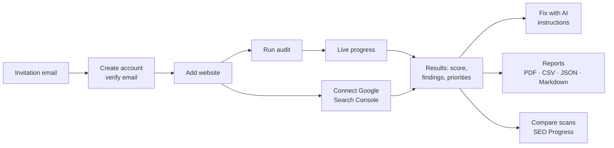
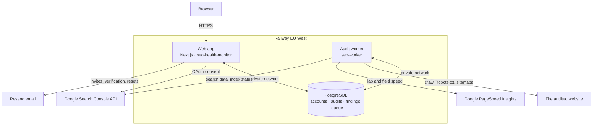
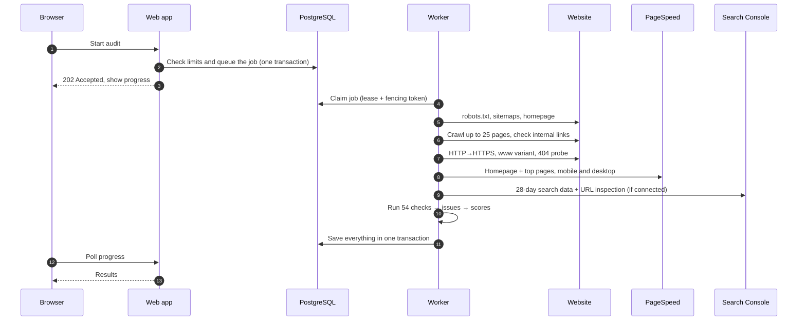
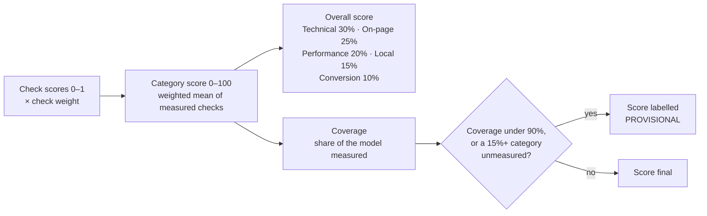

# How SEO Health Monitor works

A plain-language and technical guide to what the system does and how its audit engine reaches its results. Use it to answer questions from testers, clients and developers. The diagrams render on GitHub.

## In one paragraph

You add a website. SEO Health Monitor then:

- visits up to 25 of its pages the way a polite search-engine crawler would;
- runs **54 explicit checks** across technical SEO, on-page SEO, performance, local SEO and conversion readiness;
- measures real speed with Google PageSpeed Insights;
- optionally pulls your real Google search data from Search Console.

Every finding links to the exact page and the evidence collected, explains why it matters and gives the fix. Findings are ranked by how much they matter against how hard they are to fix. Anything that couldn't be measured is labelled **not verified**, never guessed. You can then compare scans over time, download reports, or copy ready-made **Fix with AI** instructions into an AI coding tool or hand them to a developer.

**The core promise: nothing is invented.** Every number comes from a real HTTP response, the page HTML, robots.txt, the sitemap, PageSpeed Insights or Search Console.

## What a user can do



| Area | What it offers |
| --- | --- |
| **Websites** | Up to 2 websites per beta account, with display names. Two accounts can audit the same public site independently. |
| **Audits** | Start a scan and watch live progress through crawling, link checks, PageSpeed, Search Console and analysis. Audits run in the background, so you can close the page. |
| **Results** | Overall health score and five category scores, with coverage. Findings filter by category and severity, and each has its evidence, URL, explanation, fix steps, expected benefit and priority. |
| **Fix with AI** | A self-contained, copy-paste brief for any AI coding agent (Claude Code, Cursor, Codex, Copilot) or a developer. It covers the whole plan or a single task. |
| **SEO Progress and Compare** | What was fixed, what is new and what is still outstanding between any two scans, with score trends. |
| **Search Console** | Real clicks, impressions, CTR, average position, top queries and pages, plus index status for crawled pages. |
| **Reports** | PDF, CSV, JSON and Markdown developer tasks. |
| **Account** | Profile, password, active sessions, export all your data, delete your account. |
| **Admin** (owner) | Invitations, accounts, usage and limit overrides, suspension, and an operations dashboard for workers, queue, failures and provider budgets. |

## System architecture



- The **web app** serves pages and the API, handles sign-in and **queues** audits. It never crawls anything itself.
- The **worker** picks jobs off the queue in PostgreSQL and does the slow work: crawling, PageSpeed and Google calls. More workers can be added, and the database stops two of them running the same job.
- **PostgreSQL** holds everything, separated by account (tenant). Every table row belongs to exactly one account, and the database itself rejects rows that mix accounts.

## The life of an audit



Progress is reported as it goes:

| Progress | Stage |
| --- | --- |
| 0–10% | Fetching the homepage, robots.txt and sitemaps |
| 12–60% | Crawling pages |
| 62–66% | Link checks and host checks |
| 68–92% | PageSpeed |
| 93% | Search Console |
| 94–100% | Analysis and saving |

## Step 1: the crawler

The crawler is built to be **polite** to the sites it visits and **safe** for the system running it.

- **Starting point:** it fetches the homepage, follows redirects (up to 5 hops) and audits the final domain. If that is a different domain, it says so.
- **robots.txt:** it reads the rules for its own user agent (`SEOHealthMonitor`) and skips disallowed URLs, which are listed as *blocked by robots.txt*. It honours `Crawl-delay`, capped at 5 seconds, and otherwise waits at least 300 ms between requests.
- **Page discovery:** it combines URLs from XML sitemaps (including sitemap indexes) with internal links found on each page.
  - Pages are prioritised: the homepage first, then pages linked from the homepage, then sitemap URLs, then deeper pages.
  - Low-value URLs drop down the queue: tag, author, category and pagination pages, and filter, share and add-to-cart links.
  - Only same-site HTML pages are crawled.
- **Limits:**
  - 25 pages per audit, with 2 requests in parallel;
  - 15-second timeout and 3 MB maximum per response;
  - up to 60 extra internal links status-checked without being crawled (a HEAD request, falling back to GET).
- **Site-level probes:**
  - Does `http://` redirect to `https://`?
  - Does `www.` vs bare domain consolidate to one version?
  - Does a made-up URL return a real 404, or a "soft 404" that returns 200?
- **Safety (SSRF protection):** before connecting, every URL and every redirect is checked against private, loopback, link-local and other non-public addresses, including at DNS-resolution time. Only standard web ports are allowed. Nobody can use the crawler to probe internal networks.
- **Extraction:** from each page's HTML it reads:
  - title, meta description, robots meta and canonical tags, `lang` and viewport;
  - headings, images and alt text, and internal and external links;
  - Open Graph and Twitter tags, JSON-LD and microdata;
  - word count and a content fingerprint (for duplicates);
  - phone, email, WhatsApp and maps links, and contact forms and their fields;
  - calls to action, mixed content and hreflang;
  - signs of JavaScript-only rendering;
  - the **platform**: WordPress, Shopify, Wix, Squarespace, Webflow, Next.js, Astro, Nuxt, Gatsby, Hugo, Jekyll, Joomla or Drupal.

The server HTML is read; no headless browser runs. Pages that look JavaScript-rendered are flagged, and their content findings are marked lower-confidence.

## Step 2: PageSpeed Insights

The homepage and the most-linked content pages (3 pages by default) are tested with Google's PageSpeed Insights API on **mobile and desktop**. That's 6 tests per audit.

- **Lab metrics (Lighthouse):** performance score, LCP, CLS, TBT, FCP, Speed Index, server response time, plus the top improvement opportunities.
- **Field data (real Chrome users):** LCP, INP and CLS, where Google has enough traffic data for the site.
- **Reliability:** HTTP 429 responses are retried with backoff (honouring `Retry-After`). If the quota is exhausted, remaining tests stop and are recorded as **unavailable**, not failed.
- **Budgets:** each test is reserved against the account's monthly allowance and the system-wide daily cap before it runs, so the shared Google key can't be overspent.
- **Re-run PageSpeed** re-measures an existing audit and recalculates its scores without re-crawling.

## Step 3: Google Search Console (optional)

If the user has connected Google and linked the website to a Search Console property:

- **Search data:** the last 28 finalised days (ending 3 days ago, because Google's data lags), the 28 days before that for comparison, a daily series, and the top 25 queries and landing pages.
- **URL inspection:** index status for up to 10 crawled pages, most important first. Covered pages show whether Google indexed them, the canonical Google chose, and why if not indexed.
- **Access:** read-only (`webmasters.readonly`), never write access. Tokens are encrypted at rest.
- **Separate from the score:** Search Console data never changes the on-site health score. It's shown alongside it. If Google is unreachable or the quota runs out, the audit still completes and the data is marked as not fetched.

## Step 4: the checks

Each check reads the collected data and returns a **status** (pass, warning, fail, unavailable or info), a **score** from 0 to 1 and zero or more **issues**. An issue is one problem on one URL, with its evidence.

| Category | Checks | What it covers |
| --- | --- | --- |
| **Technical SEO** | 16 | HTTPS and the HTTP→HTTPS redirect, www consolidation, status codes, broken internal links, redirect chains, robots.txt, XML sitemap, indexability (noindex), canonicals, structured-data validity, mixed content, soft 404s, server response time, JavaScript rendering*, Google index coverage* |
| **On-page SEO** | 15 | Titles (presence, length, uniqueness), meta descriptions (presence, length, uniqueness), one clear H1, heading hierarchy, image alt text, internal linking, Open Graph, thin content, duplicate content, whether the title matches the content, language declared |
| **Performance** | 7 | Mobile and desktop scores, LCP, CLS, INP (field), TBT, server response (from PageSpeed) |
| **Local SEO** | 10 | Business name, phone, address or service area, LocalBusiness schema, service areas, location pages, map or Google Business Profile link; Business Profile completeness*, reviews*, directory consistency*, local pack rankings* |
| **Conversion readiness** | 6 | Contact or quote form, click-to-call, WhatsApp, clear calls to action, mobile viewport, tap targets* |

\* Informational or "not verified" checks have zero weight. They need data the crawler can't collect honestly (for example rankings or reviews), so they are shown for completeness and **never affect the score**.

The same problem on the same URL always gets the same **issue ID**, a hash of the check, the normalised URL and a detail. That is how scans can be compared reliably even if wording changes between versions.

## Step 5: scoring



- **Category score:** the weighted average of that category's *measured* checks. Unavailable checks are left out, so they count neither as a pass nor as a fail.
- **Overall score:** the weighted average of the categories that could be measured. If a category couldn't be measured at all (for example PageSpeed was unavailable), the other weights are re-normalised.
- **Coverage:** the share of the full scoring model actually measured. A score is **provisional** when coverage is under 90%, or when a major category (Technical, On-page, Performance or Local) wasn't measured. This stops a site looking healthy just because data was missing.
- **Labels:**

| Score | Label |
| --- | --- |
| 90+ | Excellent |
| 75–89 | Good |
| 50–74 | Needs work |
| Under 50 | Poor |

## Step 6: prioritising what to fix

Each issue has a severity (critical, high, medium or low), an expected impact (1–5), an effort (low, medium or high) and a confidence (high, medium or low).

```
priority = severity weight × confidence factor × effort factor + impact × 4
```

| Factor | Values |
| --- | --- |
| Severity weight | critical 100 · high 70 · medium 40 · low 15 |
| Confidence factor | high 1.0 · medium 0.8 · low 0.55 |
| Effort factor | low 1.0 · medium 0.8 · high 0.6 |

The result puts each issue in a bucket:

| Priority | Bucket |
| --- | --- |
| 70 or more | Fix first |
| 40–69 | Fix next |
| Under 40 | Plan later |

High-severity, high-confidence, quick fixes rise to the top.

## Step 7: outputs

- **Fix with AI:** a deterministic Markdown brief built only from verified findings. Nothing is generated by a model. It includes:
  - the detected platform and where to look in it;
  - exact URLs and evidence, grouped by fix area (page head, hosting, content, crawl files, structured data, performance);
  - guardrails, acceptance criteria and a verification step for each task.

  Low-confidence findings are left out unless the user opts in. Text copied from the crawled website is fenced off as untrusted data, so a malicious page can't inject instructions into the AI tool.
- **Reports:** PDF (printable, with developer fix instructions), CSV (one row per issue), JSON (everything) and Markdown tasks.
- **Compare and SEO Progress:**
  - Issues are matched by ID across scans: *fixed*, *new* or *still outstanding*.
  - Score and Search Console trends are charted.
  - When coverage changes (for example PageSpeed was measured this time but not last time), it's flagged, so a newly measured category isn't mistaken for improvement.
- **AI consultant report** (optional; on in the beta, using Claude Sonnet 5.5; one per audit, 5 per account a month, and at most $1 a day of AI spend across all accounts): a narrative report written by Claude from the measured data only. It must not invent numbers, rankings or competitors, and treats crawled text as data.

## Multi-user design and reliability

- **Accounts and isolation:** each user has a personal account (tenant). Every query filters by the signed-in user's account, and database keys bind every website, audit, finding and Google record to one account. Guessing another account's audit ID returns the same "not found" as an ID that doesn't exist. Administrators can't silently view customers' audits.
- **Invite-only:** registration needs a valid, single-use invitation tied to the email address, then email verification. There's no open sign-up.
- **Limits:** applied atomically when an audit is queued and when each PageSpeed or AI call is reserved, so parallel requests can't overspend. Usage history survives deleting a website, which stops quota resets.
- **Queue reliability:**
  - A worker holds a **lease** on a job and renews it with heartbeats.
  - If the worker dies, the lease expires and another worker retries the job with exponential backoff, a limited number of times.
  - Every write a worker makes is checked against a **fencing token**, so a frozen worker that wakes up late can't overwrite newer results.
  - Results are saved in one transaction, so a retry never leaves half an audit.
- **Graceful shutdown:** on deploy, running jobs are handed back without using up a retry.

## Limitations

These are good to say up front when asked.

- **JavaScript-only sites:** content is read from the server's HTML. Single-page apps that render everything in the browser are flagged, and their content findings are marked lower-confidence.
- **Scope:** 25 pages per audit in the beta. External links aren't checked.
- **PageSpeed:** lab scores vary a little between runs. Field data (real-user INP) only exists for sites with enough Chrome traffic.
- **Search Console:** data lags 2–3 days. While Google's consent screen is in testing mode, only approved Google accounts can connect, and connections expire weekly.
- **Local SEO:** address and service-area detection is heuristic. Google Business Profile, reviews, citations and local rankings need external data and are shown as **not verified**.
- **Not yet built:** scheduled or recurring scans, team accounts, competitor tracking, billing.

## Answers to common questions

**How is this different from a free online SEO checker?** It crawls many pages, not just one URL. Every finding has evidence and an exact fix. It separates "measured" from "not verified" instead of guessing. It tracks progress between scans. And it hands you implementation-ready instructions for an AI coding tool or a developer.

**Where does the score come from?** It's a weighted average of 47 scored checks across five categories, using only what was actually measured. The methodology is shown in the app.

**Does it change my website?** No. It only reads public pages, the same way Google's crawler does, and respects robots.txt.

**Does it use AI to make up findings?** No. Findings come from fixed, deterministic checks on real data. AI is only used, optionally, to write a narrative summary, and it is restricted to the measured data.

**What does it need from me for Google data?** Read-only consent to Search Console. It can't change anything in your Google account, and you can disconnect at any time.

**Is my data safe?**
- Your data is isolated per account and the site uses HTTPS everywhere.
- Passwords are hashed and Google tokens are encrypted.
- You can export your data or delete your account yourself.
- It's hosted on Railway in the EU (Netherlands). Details are in [SECURITY-AND-PRIVACY.md](SECURITY-AND-PRIVACY.md).

**Why is my score "provisional"?** Something important couldn't be measured, usually PageSpeed (quota or timeout) or a blocked crawl. The score covers only part of the model, so it's flagged rather than overstated.

## Where it lives in the code

| Area | Path |
| --- | --- |
| Crawler (fetching, SSRF, robots.txt, sitemaps, extraction) | `src/lib/crawler/` |
| Checks, scoring, issues, compare, progress | `src/lib/audit/` (checks in `checks/*.ts`) |
| Shared audit pipeline | `src/lib/audit/pipeline.ts` |
| PageSpeed client | `src/lib/performance/pagespeed.ts` |
| Search Console | `src/lib/integrations/search-console/` |
| Reports, Fix with AI | `src/lib/reports/` |
| Accounts, queue, worker, limits, admin | `src/lib/saas/` |
| Customer pages and API | `src/app/beta/`, `src/app/api/beta/` |
| Routing of old URLs | `src/proxy.ts`, `src/lib/saas/unified-routes.ts` |
| Database schema and migrations | `src/lib/saas/*schema.ts`, `drizzle-saas/` |
